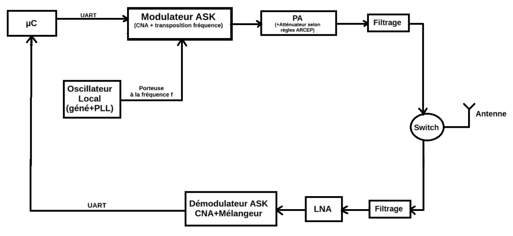

# Projet de Transmission UART Sans Fil
Projet Système réalisé en troisième année spécialité Electronique et Systèmes de Communication à l'ENSEA : 

> Mise en place d'une communication sans fil USART avec un drône

## Cahier des charges

L'objectif de ce projet est de concevoir une chaîne de transmission/réception RF à partir de composants existants. Cet émetteur-récepteur est destiné à la communication avec un drone. Il y a donc une contrainte de place sur au moins une des versions du système.

Contraintes générales :

    Portée du système : 10m
    Durée du projet : 40h
    Budget : 250€

Paramètres de l'USART fourni : 

    Débit : 115 200 baud
    8 bits de données
    1 bit de parité (pair)
    1 bit de stop

## Choix de la fréquence porteuse et de la modulation
Nous avons choisi une porteuse à **868MHz**, ainsi que la modulation **ASK**,
 - Notre choix s'est porté sur la modulation ASK afin d'obtenir une portée nettement supérieure. De plus, nous avons pris en compte l'expérience d'un groupe ayant réalisé ce même projet en 2025 avec la modulation BPSK : leur choix avait entraîné de lourdes difficultés, notamment au niveau de la démodulation et de la récupération de la porteuse en phase. Cette dernière nécessitait en effet une PLL sans erreur de phase, alors qu'une PLL est initialement conçue pour minimiser les erreurs de fréquence.
 - En ce qui concerne la fréquence, nous avons choisi de réutiliser les composants des années précédentes afin de réduire les coûts. De plus, opter pour la bande des 2,4 GHz très proche de la band Wi-Fi nous aurait exposé à de nombreux signaux parasites, qui auraient été difficiles à filtrer.

## Vue d'ensemble du système émission/réception
Voici une description de notre système. Celui-ci s'organise autour d'une chaîne d'émission (composée du modulateur ASK, du PA et du filtrage) et d'une chaîne de réception (composée du filtrage, du LNA et du démodulateur ASK). Pour permettre l'utilisation d'une seule antenne dans les deux modes, les deux chaînes sont reliées par un Switch RF qui permet de passer d'un mode à l'autre. L'ensemble est piloté par un microcontrôleur µC et la porteuse elle est générée par l'oscillateur local : 

Dans un premier temps, nous avons découpé le système par fonctions : chaque binôme s'est vu assigner une tâche spécifique et devait réaliser un premier PCB (2 couches) dédié. Dans un second temps, une fois les tests validés, un PCB unique à 4 couches a été conçu pour regrouper l'ensemble du système.

## Description de la chaîne d'émission
Le rôle principal de la chaîne d'émission, consiste à traiter les données numériques reçues par liaison UART, à générer une porteuse radiofréquence à 868 MHz (stabilisée par un oscillateur local à boucle à verrouillage de phase (PLL)), puis à appliquer une modulation d'amplitude de type ASK (Amplitude Shift Keying). Le signal ainsi modulé traverse ensuite un étage de filtrage avant d'être acheminé vers l'antenne.
     Le développement de cette chaîne d'émission a été structuré autour de plusieurs objectifs clés :
         1-Garantir l'intégrité et la fiabilité de la transmission des données numériques via l'interface UART.
         2-Produire un signal porteur RF stable, propre et paramétrable.
         3-Exécuter une modulation ASK fidèle aux trames de données à transmettre.
         4-Filtrer efficacement le signal radiofréquence pour respecter les normes en vigueur avant son émission par l'antenne.

## Description de la chaîne de réception
choix des composants modules par module
