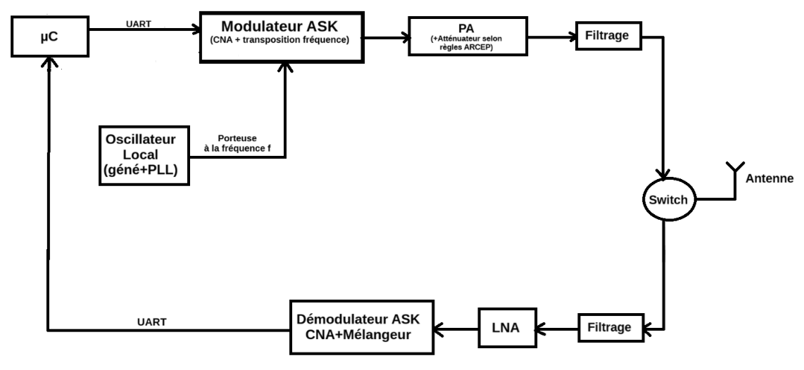
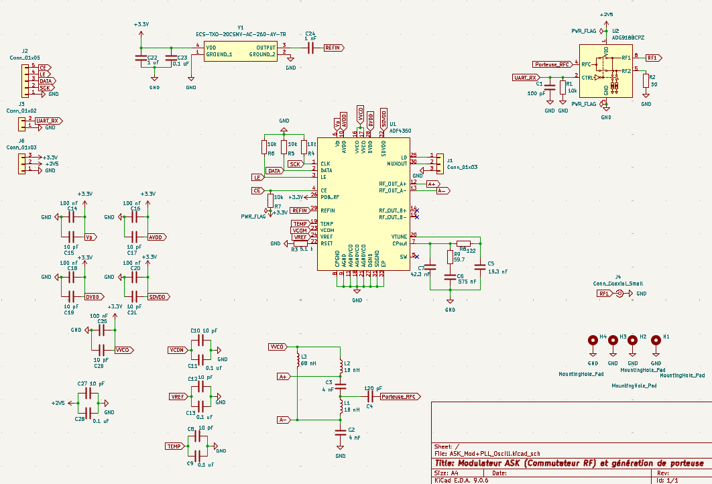
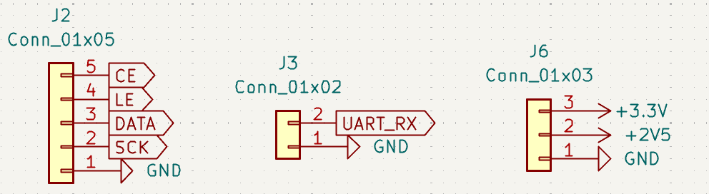
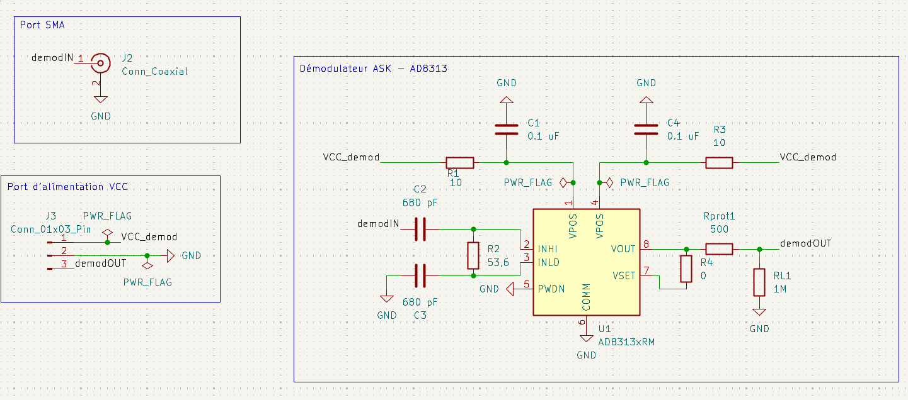
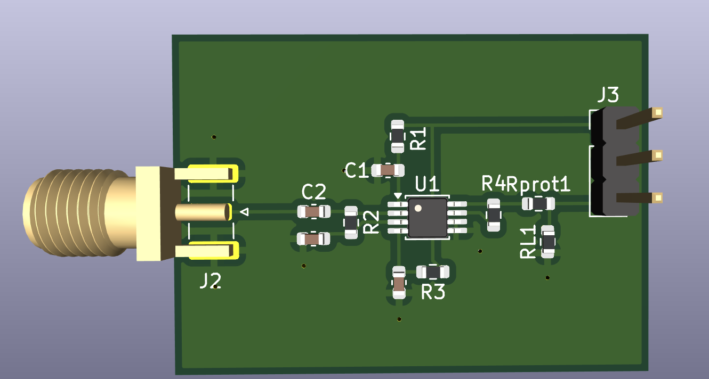

# Projet de Transmission UART Sans Fil
Projet Système réalisé en troisième année spécialité Electronique et Systèmes de Communication à l'ENSEA : 

> Mise en place d'une communication sans fil USART avec un drône

## Cahier des charges

L'objectif de ce projet est de concevoir une chaîne de transmission/réception RF à partir de composants existants. Cet émetteur-récepteur est destiné à la communication avec un drone. Il y a donc une contrainte de place sur au moins une des versions du système.

Contraintes générales :

    Portée du système : 10m
    Durée du projet : 40h
    Budget : 250€

Paramètres de l'USART fourni : 

    Débit : 115 200 baud
    8 bits de données
    1 bit de parité (pair)
    1 bit de stop

## Choix de la fréquence porteuse et de la modulation
Nous avons choisi une porteuse à **868MHz**, ainsi que la modulation **ASK**,    
- Notre choix s'est porté sur la modulation ASK afin d'obtenir une portée nettement supérieure. De plus, nous avons pris en compte l'expérience d'un groupe ayant réalisé ce même projet en 2025 avec la modulation BPSK : leur choix avait entraîné de lourdes difficultés, notamment au niveau de la démodulation et de la récupération de la porteuse en phase. Cette dernière nécessitait en effet une PLL sans erreur de phase, alors qu'une PLL est initialement conçue pour minimiser les erreurs de fréquence.    
- En ce qui concerne la fréquence, nous avons choisi de réutiliser les composants des années précédentes afin de réduire les coûts. De plus, opter pour la bande des 2,4 GHz très proche de la bande Wi-Fi nous aurait exposé à de nombreux signaux parasites, qui auraient été difficiles à filtrer.

# Vue d'ensemble du système émission/réception
Voici une description de notre système. Celui-ci s'organise autour d'une chaîne d'émission (composée du modulateur ASK, du PA et du filtrage) et d'une chaîne de réception (composée du filtrage, du LNA et du démodulateur ASK). Pour permettre l'utilisation d'une seule antenne dans les deux modes, les deux chaînes sont reliées par un Switch RF qui permet de passer d'un mode à l'autre. L'ensemble est piloté par un microcontrôleur µC et la porteuse elle est générée par l'oscillateur local :    
    

Dans un premier temps, nous avons découpé le système par fonctions : chaque binôme s'est vu assigner une tâche spécifique et devait réaliser un premier PCB (2 couches) dédié. Dans un second temps, une fois les tests validés, un PCB unique à 4 couches a été conçu pour regrouper l'ensemble du système.

# Description de la chaîne d'émission
Le rôle principal de la chaîne d'émission, consiste à traiter les données numériques reçues par liaison UART, à générer une porteuse radiofréquence à 868 MHz (stabilisée par un oscillateur local à boucle à verrouillage de phase (PLL)), puis à appliquer une modulation d'amplitude de type ASK (Amplitude Shift Keying). Le signal ainsi modulé traverse ensuite un étage de filtrage avant d'être acheminé vers l'antenne.
     Le développement de cette chaîne d'émission a été structuré autour de plusieurs objectifs clés :
          1- Garantir l'intégrité et la fiabilité de la transmission des données numériques via l'interface UART.
          2- Produire un signal porteur RF stable, propre et paramétrable.
          3- Exécuter une modulation ASK fidèle aux trames de données à transmettre.
          4- Filtrer efficacement le signal radiofréquence pour respecter les normes en vigueur avant son émission par l'antenne.
## Bloc génération de la porteuse et modulation ASK
Cette partie décrit le fonctionnement des premiers bloc (Modulateur ASK et Oscillateur Local) de la chaîne détaillée précédemment, la génération de la porteuse sera réalisée par le synthétiseur de fréquence à boucle à verrouillage de phase (PLL) l’ADF4350, afin d’avoir une référence de fréquence, ce dernier sera relié à l’oscillateur ECS-TXD-20CSMV-AC-260-AY-TR et enfin pour réaliser la modulation ASK, nous utiliserons un switch RF, l’ADG918BCPZ.

### 1- interface Nucléo/PCB RF
La communication entre la carte microcontrôleur (Nucleo STM32) et le PCB RF est assurée par plusieurs connecteurs dédiés :

     • Connecteur d'interface SPI (J2) : regroupant les signaux de configuration SCK (horloge de communication), DATA (données de configuration), LE (validation du registre sélectionné) et CE (activation du composant), ainsi que la masse GND, permettant le paramétrage du synthétiseur de fréquence.
     • Connecteur de commande (J3) : acheminant le signal de commande UART_RX issu du microcontrôleur vers le modulateur ASK.
     • Connecteur d'alimentation (J6) : fournissant les tensions +3.3V, +2V5 (utiles pour alimenter l’ADF4350, ADG918 et l’oscillateur) et la référence de masse GND à la carte.

 La configuration du synthétiseur de fréquence ADF4350 (U1) est réalisée via une interface série synchrone de type SPI. Cette interface permet notamment :
     • l’écriture des registres de configuration de la PLL
     • l’initialisation et la réinitialisation du composant
     • la reprogrammation dynamique de la fréquence de sortie.
   
### 2- Génération de la porteuse
La génération de la porteuse radiofréquence est assurée par le composant ADF4350 (U1) d’Analog Devices. Ce circuit intègre un oscillateur commandé en tension (VCO) interne couvrant une large plage de fréquences, ainsi que l’ensemble des blocs nécessaires à la réalisation d’une PLL fractionnaire ou entière. 
 La référence de fréquence (26MHz) est fournie par l’oscillateur à quartz Y1 (ECS-TXD-20CSMV-AC-260-AY-TR) connecté à l’entrée REFIN via le condensateur C24 (capacité bouchon de 1 nF). Dans cette application, l’ADF4350 est configuré pour fournir une porteuse à 868 MHz.

###3- Modulation ASK
 -> SMA vers le PCB amplificateur de puissance et filtrage
  Vue d'ensemble du PCB

## Bloc amplificateur de puissance et filtrage
La sortie du modulateur est réglable en puissance entre -4dBm et 5dBm, ce qui n'est pas suffisant pour atteindre la portée voulue. 

Nous avions en stock des amplificateurs SKY66185-11, utilisés pour un projet semblable l'année précédente. Ces amplificateurs Skyworks à forte linéarité fournissent un gain supplémentaire de $36.5$ dB, sur une bande de  $851$ à $894$ MHz.

> Bilan de puissance à faire

# Switch RF et antenne
Commutation entre les 2 modes -> Johan

# Description de la chaîne de réception
choix des composants modules par module
## Bloc filtrage et LNA

Le signal capté par l'antenne est amplifié par le LNA **GRF2070**, puis filtré par le filtre SAW **SF2425E** centré sur 868,6 MHz.

| Réf. | Valeur | Rôle |
|:--:|:--:|:--|
| C1 / C2 | 47 pF / 4,7 pF | Liaison entrée / sortie du LNA (blocage du continu) |
| R2 | 910 Ω | Polarisation : fixe IDD ≈ 70 mA sous 5 V |
| L1 | 22 nH | Self de choc : amène le 5 V sur `RF_OUT/VDD` |
| C3 / C4 | 100 nF / 100 pF | Découplage BF / HF |
| L2, C6 / L3, C7 | 22 nH, 2,7 pF / 33 nH, 3,9 pF | Adaptation 50 Ω ↔ filtre SAW (≈ 386 Ω ∥ 1,6 pF) |

**Pourquoi LNA → filtre ?** D'après la formule de Friis, $F = F_1 + (F_2-1)/G_1$. Placé derrière 21 dB de gain, le filtre ne dégrade presque pas le bruit : **NF ≈ 0,43 dB**, contre ≈ 3 dB si le filtre était placé avant le LNA. Le signal ASK à 115,2 kbaud occupe environ 230 kHz et passe sans déformation dans la bande de 1,5 MHz du filtre.

| Chaîne complète | Gain ≈ **18,4 dB** | NF ≈ **0,43 dB** | Alim. **5 V / 70 mA** |
|:--|:--:|:--:|:--:|
## Bloc Démodulateur
### 1. Présentation et choix du composant

Ce PCB a été conçu sous **KiCad 9.0** pour réaliser la démodulation d'un signal radiofréquence modulé en amplitude (**ASK**), dans le cadre du projet de transmission USART sans fil entre une station au sol et un drone.

Le circuit repose sur l'**AD8313 d'Analog Devices**, un détecteur logarithmique RF fonctionnant sur une plage de fréquences de **100 MHz à 2,5 GHz**.

Ce composant a été choisi pour :
- Sa compatibilité avec les fréquences envisagées de **868 MHz et 918 MHz**.
- Sa capacité à détecter des signaux RF de faible puissance.
- Sa sortie analogique permettant de récupérer l'enveloppe du signal ASK.
- Son faible encombrement, adapté à la conception d'un PCB compact.

Le PCB intègre également un réseau d'adaptation RF, des condensateurs de découplage et un plan de masse sur la couche **B.Cu**.

### 2. Connecteur SMA – Entrée RF (J2)

Le connecteur **SMA J2** constitue l'entrée radiofréquence du PCB.

Il permet de raccorder une antenne ou un générateur RF à l'aide d'un câble coaxial de **50 Ω**.

Le signal reçu traverse le condensateur de liaison **C2 (680 pF)**, qui bloque la composante continue, avant d'atteindre l'entrée **INHI** de l'AD8313.

La résistance **R2 (53,6 Ω)** participe à l'adaptation de l'entrée RF à une impédance proche de 50 Ω afin de limiter les réflexions.

Le connecteur SMA a été choisi pour faciliter les tests avec les équipements RF disponibles au laboratoire.

### 3. Connecteur J3 – Alimentation et sortie démodulée

Le connecteur **J3 à trois broches** regroupe l'alimentation, la masse et la sortie du démodulateur.

| Broche | Signal | Fonction |
|--------|--------|----------|
| 1 | VCC_demod | Alimentation du circuit |
| 2 | GND | Masse commune |
| 3 | demodOUT | Sortie analogique démodulée |

L'alimentation des deux broches **VPOS** de l'AD8313 passe par les résistances **R1 et R3 (10 Ω)**, associées aux condensateurs de découplage **C1 et C4 (100 nF)** pour réduire les perturbations sur l'alimentation.

La sortie **VOUT** est reliée à **VSET** par une résistance de **0 Ω (R4)** et traverse une résistance de protection **Rprot1 (500 Ω)** avant d'atteindre le connecteur J3.

Une résistance **RL1 (1 MΩ)** est également connectée entre la sortie et la masse.

Ce connecteur facilite l'intégration du démodulateur avec les autres blocs du système de communication.
Voici sa visualisation en 3D 

